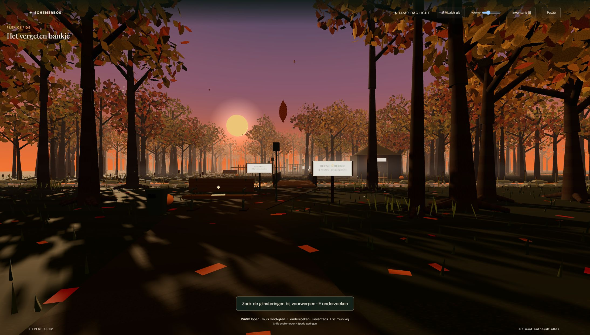

# Schemerbos De laatste zon

Een interactieve escape room van ongeveer 15 minuten over **AI-hallucinaties**. Gemaakt door **Chaja Zeiss**, met hulp van AI, voor de eindopdracht Gen-AI Basics.

Je loopt door een mistig herfstbos bij zonsondergang. Onderzoek voorwerpen, controleer uitspraken van een AI-bosassistent, verzamel bewijsstukken en open de poort voordat de zon ondergaat. Na 10 minuten gebeurt er iets onheilspellends.



## Starten

Dit project is een zelfstandige website. Je hebt geen API-sleutel, account, betaalde dienst of installatie van projectbibliotheken nodig. Gebruik een recente desktopversie van Chrome, Edge of Firefox met een toetsenbord en muis.

Omdat de 3D-code JavaScript-modules gebruikt, moet je de bestanden via een lokale webserver openen. **Dubbelklikken op index.html werkt niet betrouwbaar.**

### Met Python

1. Download of clone deze repository.
2. Open een terminal in de projectmap.
3. Start de server:

```text
python -m http.server 8000
```

Op Windows kan ook:

```text
py -m http.server 8000
```

4. Open http://localhost:8000 in je browser.
5. Lees de uitleg en klik op **Betreed het bos**. De timer begint na de intro.

### Met Visual Studio Code

Open de projectmap in VS Code en start index.html met de extensie **Live Server**.

### GitHub Pages

Dit is een statische website. Je kunt de repository via **Settings → Pages → Deploy from a branch** publiceren, vanuit de hoofdbranch en de map **/(root)**. Gebruik daarna de link die GitHub zelf toont.

## Besturing

| Toets of bediening | Actie |
| --- | --- |
| W A S D of pijltjestoetsen | Lopen |
| Muis | Rondkijken |
| E | Gericht voorwerp onderzoeken |
| I of inventarisknop | Inventaris openen |
| Spatie | Springen |
| Shift | Sneller lopen |
| Esc | Muis vrijmaken of intro overslaan |
| Pauze | Tijd en lopen pauzeren |
| Geluidsknop en volumeschuif | Muziek en geluid aanpassen |

Als muisvergrendeling niet wordt ondersteund, werkt rondkijken met de muis boven het spelbeeld. Je kunt ook slepen. Na een opdracht wordt de muisbesturing automatisch hervat.

## Leerdoelen

Na het spelen kun je:

- Uitleggen dat een overtuigend AI-antwoord onjuist of verzonnen kan zijn.
- Een AI-uitspraak vergelijken met een bewijsstuk.
- Controleren of een bron bestaat en de bewering ondersteunt.
- Onderscheid maken tussen een onjuiste claim en onvoldoende bewijs.
- Een controleplan maken en belangrijke claims bij onafhankelijke bronnen controleren.

Alle bosnamen, registers en feiten in de opdrachten zijn fictieve spelgegevens.

## Spel en bespreking

De opdrachten staan bij het bankje, de rivierkist, het beheerdersregister, de wegwijzer en de poort. Het spel geeft uitleg na een goed antwoord en laat opnieuw proberen toe. Voor ontsnappen moeten alle vijf opdrachten zijn opgelost. Bij tijdsoverschrijding kun je zonder tijdslimiet verder oefenen. Na ontsnappen volgt een filmische outro en een eindbeeld met een knop terug naar het begin.

Reserveer ongeveer 15 minuten om te spelen. Bespreek daarna kort: welk AI-antwoord vertrouwde je bijna, en hoe zou je het buiten het spel controleren? De werkelijke speelduur moet nog door een externe tester worden gemeten.

## Bestanden

- `index.html` — uitleg, schermen, inventaris en dialoogvensters.
- `style.css` — vormgeving van schermen en bediening.
- `game.js` — opdrachten, bewijsstukken, timer, feedback en eindscherm.
- `world.js` — 3D-bos, lopen, botsingen, rivier, intro, outro en geluid.
- `vendor/three.module.js` — lokaal opgeslagen Three.js r160.
- `LICENSE-THREE.txt` — MIT-licentie van Three.js.
- `preview.png` — voorbeeldafbeelding.
- `TESTPLAN.md` — testinstructies voor de externe tester.

De materialen, 3D-voorwerpen en geluiden worden in het spel gegenereerd. Voor de lettertypen wordt Google Fonts gebruikt; als dat niet bereikbaar is, worden lokale vervangende lettertypen gebruikt. De spelwerking gebruikt geen externe AI-API.

## Ontwikkeling en controle

De activiteit is in meerdere rondes met AI ontwikkeld en verbeterd op basis van mijn eigen beoordelingen. Levi vond het pitchidee creatief en noemde geen verbeterpunten. De AI heeft tijdens de ontwikkeling technische controles uitgevoerd op de opdrachten, botsingen, timer, inventaris, intro, outro en geluiden. Er zijn ook beelden in de browser gecontroleerd.

**Een externe gebruikerstest is nog niet uitgevoerd.** Ik wil na goedkeuring mijn moeder laten testen. Haar feedback en eventuele aanpassingen voeg ik daarna toe aan het verslag.

## Licentie van de bibliotheek

Three.js is een externe bibliotheek onder de MIT-licentie. De auteursvermelding is in het bronbestand behouden; de volledige bibliotheeklicentie staat in LICENSE-THREE.txt.
